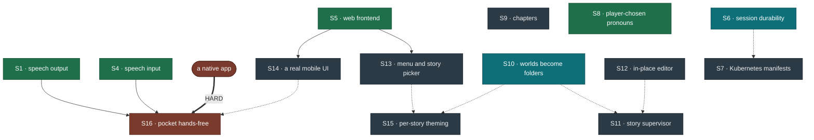

# Roadmap

Everything past the MVP. [MVP-Plan.md](MVP-Plan.md) covers T0–T12, which are done;
this file is what comes after, and it is the canonical list — the plan points here
rather than repeating it.

Items are numbered in the order they were proposed, **not** by priority. S16 is not
less important than S1, it is just newer.

---

## The tree

Only **one** edge in this whole roadmap is genuinely hard. Everything else is a
preference with a price, so each soft edge below says what going around it costs.

*Green is shipped · teal is what I would pick up next · red is blocked on something
outside this project · slate is everything else. A solid arrow is a hard dependency,
a dotted one is a preference. S2 (braille) and S3 (local model) are settled and sit
outside the graph — see the table below.*

The soft edges, and what each one costs to skip:

- **S6 → S7** *(soft, strong)* — you can deploy to Kubernetes without session
  durability, on a single replica, accepting that every pod restart kills whatever
  games were in flight. It bit us once already on a `docker rm`.
- **S10 → S11, S15** *(soft)* — both want somewhere to put a file. They can find one
  by naming convention instead, which is what we do now and what stops scaling around
  five worlds.
- **S9 → a second scene** *(soft, and possibly not a dependency at all)* —
  `move_player` already exists, so if a scene turns out to be four rooms and a
  conversation it needs no engine work. Writing one is what will decide.
- **A native app → S16** *(hard, and the only genuinely hard edge here)* — iOS
  suspends JavaScript when Safari is backgrounded and speech recognition stops with
  it. No amount of front-end work changes that.

**S8 was a cost curve, and it has been paid.** Pronoun templating is small while
there are a few hundred lines of prose and a rewrite once there are a few thousand,
so it went in before the prose grew rather than after it. The tokens exist, the
settings panel sets them, and no prose has had to be revisited — because there was
none to revisit yet, which was the whole argument for doing it now.

---

## What I would do next

1. **S10 — worlds as folders**, because it is mechanical, it is cheapest now, and two
   other items are waiting on somewhere to put a file.
2. **S6 — session durability**, if the Kubernetes lab is still the goal.
3. **A second scene**, now that S8 has cleared the way for one.

Everything else is genuinely optional and can happen in any order.

---

## Status

| | | |
|---|---|---|
| **S1** | speech output | ✅ done — browser TTS, not macOS `say` |
| **S2** | braille / structured mode | ⏸ shelved — no way to validate it without a reader |
| **S3** | local model provider | ✅ done — LM Studio works; no local model is good enough yet |
| **S4** | speech input | ✅ done — browser recognition, hands-free loop |
| **S5** | web frontend | ✅ done, past spec |
| **S6** | session durability | ⬜ not started · *recommended next* |
| **S7** | Kubernetes manifests | ⬜ not started |
| **S8** | player-chosen pronouns | ✅ done — tokens, settings panel, `pronouns` command |
| **S9** | chapters | ⬜ not started |
| **S10** | worlds become folders | ⬜ not started · *recommended next* |
| **S11** | story supervisor | ⬜ not started |
| **S12** | in-place editor | ⬜ not started |
| **S13** | wrapper around the game loop | ⬜ not started |
| **S14** | a mobile interface worth using | ⬜ not started |
| **S15** | per-story theming | ⬜ not started |
| **S16** | pocket hands-free | ⛔ blocked — needs a native app |

---

## The items

- **S1 — Speech output.** ✅ **Done, by a different route than planned.** The plan
  was a `--speech` flag piping to macOS `say`. What shipped is browser speech
  synthesis in the web UI, which works on any device rather than one laptop and
  arrived free with S5. The renderer gained a SPEECH register alongside the written
  one: no decoration, blocked exits as their own sentences, and a room already
  visited loses its description entirely — 401 characters down to 149 on the third
  crossing of a corridor. `say` in the CLI remains unbuilt and is no longer
  interesting.

- **S2 — Verbose/structured accessibility mode.** ⏸ **Shelved deliberately.**
  `--verbose-rooms`, one short sentence per fact, for braille displays and
  screen-reader line navigation. The design work was done and most of it turned out
  not to be braille-specific at all: front-loading actionable facts, dropping
  decorative characters, one idea per line. All of that shipped in the SPEECH
  register instead.

  It is shelved for an honest reason rather than a scheduling one: **neither of us
  reads braille**, and building accessibility features without the users is how you
  get well-meaning garbage. Measured, a room entry costs eleven pans on a 40-cell
  display with the exits buried behind a seven-pan paragraph, so there is real work
  here — it just wants a reader in the room before it wants a programmer.

- **S3 — Local model provider (LM Studio first):** `LMStudioNLU(NLUProvider)` against
  LM Studio's OpenAI-compatible endpoint (`http://localhost:1234/v1`), using its
  JSON-schema structured output; same `NLUWireResponse` schema, same validation
  funnel, same engine. Largely de-risked already: `OpenRouterNLU` proved a foreign
  backend drops straight into the protocol, and the funnel held across six models of
  varying quality — so this is mostly a base URL, an auth header that isn't needed,
  and a `build_sink`-style entry in the provider factory.
  *Hosting note:* a laptop-local LM Studio is fine for a first pass but is not a
  path to serving this from the k8s cluster — that would need the model running as
  its own service (vLLM, Ollama, or LM Studio's headless server on a GPU node) with
  the game pointed at it over the network. Well beyond MVP; the point of the first
  pass is only to prove the game plays with no external API at all.

  ✅ **Done, and the answer is not yet.** `LMStudioNLU` works and the plumbing is
  sound — LM Studio honoured strict `json_schema` on every call across two models.
  The models are the problem: Llama 3.2 3B scored 15% and Llama 3.1 8B 15% on the
  work that actually reaches a model, against 85% for Sonnet, both failing the same
  way by refusing to commit. Worth re-testing when a better small model appears; the
  provider is already there. See [docs/EXPERIMENTS.md](docs/EXPERIMENTS.md).

- **S4 — Speech input.** ✅ **Done, by a different route than planned.** The plan
  was push-to-talk via `hear` or whisper.cpp. What shipped is the browser's own
  recognition driving a continuous hands-free loop: listen, play the turn, speak the
  reply, listen again, with the microphone shut while the synthesiser talks so the
  game does not transcribe its own voice and answer itself.

  Two constraints found the hard way. **Speech input needs a secure context** — over
  plain http on a LAN address the browser refuses before offering a permission
  prompt, so hands-free needs https or localhost while speech *output* works
  anywhere. And a real spoken playthrough proved audible turn-taking is not
  decoration: without a chime the player talks into a closed microphone and repeats
  himself, which is legible in the log as "go north go north".

- **S5 — Visual/web frontend:** a small web server that renders `RoomDescribed`
  events as a schematic; the engine library is untouched.
  *Status: done, and past spec* — `web.py` plus `static/index.html` give a playable
  browser UI (transcript, tappable exits, live inventory, browser speech). Every
  response carries both the rendered prose and the structured events behind it.

- **S6 — Session durability:** *important, gates S7.* Sessions live in memory, so a
  restart drops every game in progress and a second replica breaks them outright.
  Three options, cheapest first: accept it and run one replica; move sessions to a
  shared store (Redis); or make the server stateless by having the client hold a
  signed snapshot of the world — only ~2.6 KB gzipped, since it is the same JSON the
  save system already emits. The third is the best fit for Kubernetes: any replica
  can serve any turn, restarts are invisible, and there is no new dependency. Sign
  the snapshot (HMAC, server-held key) so a tampered world is rejected rather than
  trusted — the engine stays the only source of truth.

- **S7 — Kubernetes manifests:** Deployment, Service, Ingress, and a Secret for the
  API key. Liveness and readiness both point at `/healthz`, which already exists and
  is cheap. Needs a registry the cluster can pull from. **Do S6 first** — shipping
  in-memory sessions to a cluster that reschedules pods on its own schedule means
  players lose games for no reason.

- **S8 — Player-chosen pronouns:** ✅ **done.** The player picks he/him, she/her or
  they/them from a settings panel in the web version or `pronouns <set>` in the
  terminal. Prose writes `{they}`/`{them}`/`{their}` tokens, plus `{s}` and the four
  irregular verbs, and `adventure/pronouns.py` substitutes them **at render time** —
  so the choice can change mid-game, applies to prose written before the change, and
  travels in saves. A world declares the default its prose was written for
  (`"pronouns"` at the top of the world file); the player's choice overrides it and is
  remembered per browser. `lint_world.py` and `prose.py apply` both report brace
  tokens they do not recognise, because `{thier}` is valid JSON and valid prose and
  nothing else would catch it.

  **Only the protagonist is templated.** Other characters' pronouns are words in
  their prose, which is correct — a character is who they are, not a setting.

  **No existing prose uses a token yet**, because the protagonist is "you" in every
  line currently written. That is the point: the mechanism landed while converting
  cost nothing. Converting hand-written pronouns to tokens in prose written from here
  is exactly the sweep **S11, the story supervisor**, should own — it is mechanical,
  it needs the whole world in view at once, and it is the kind of thing a human
  reviewer would rubber-stamp and an author would forget.

- **S9 — Chapters: more than one scene in a story.** A world file is currently a
  whole game, and a story told in scenes needs state to survive the boundary — what
  the player carries, which flags are set, who is travelling with them. `move_player`
  already moves someone between rooms, so a scene that is *more rooms in the same
  file* needs no engine work at all and is the cheap answer for two or three scenes.
  Separate files become worth it when scenes are long enough that one file stops
  being editable, and that is the version that needs design: a manifest naming the
  order, a declared carry-over set (inventory, named flags, companions), and an
  ending that names the next chapter rather than just an outcome. Worth doing before
  the second scene is written, not after, because retrofitting the carry-over means
  re-auditing every flag already in use.

- **S10 — Worlds become folders.** `worlds/wayfarer/` holding `world.json` as the
  load-bearing piece plus its companions: `prose.md`, the story supervisor's
  instructions (S11), and eventually a theme (S15). Today those sit beside each other
  by naming convention, which works for two worlds and stops working somewhere
  around five. Touches `load_worlds` in web.py, `--world` on the CLI, `prose.py`'s
  path handling, and the fixtures — all mechanical, and all cheaper now than later.
  **Do this before S11 and S15**, both of which want somewhere to put a file.

- **S11 — Story supervisor.** A Claude skill that reviews a content diff for
  continuity breaks, dropped threads, and drift from a world's declared voice. It
  loads what the game never sees: the prose doc's Voice and Continuity blocks, which
  is where a world's unwritten rules — what a character would never do, what happened
  off-screen that no line states — actually live. Running it on `git diff` rather than the whole world keeps
  it cheap and points it at what just changed.

  *The case for it is that we have already done this job by hand and it found real
  bugs.* A single editing pass turned up an elapsed time stated one way in the intro
  and another way in five later lines, a location detail left over from a setting
  that had since changed, and a plot beat that quietly stopped working the moment the
  protagonist's equipment changed. None of those are things a test can catch, and all
  of them are things a careful reader catches every time.

  **It should also own the pronoun sweep.** S8 shipped `{they}`/`{them}`/`{their}`
  tokens and left every existing line alone, because every existing line says "you".
  As prose grows, some of it will name the protagonist in the third person with a
  hard-coded *he* or *she*, and finding those is exactly this job: mechanical,
  whole-world, and precisely the sort of thing an author forgets and a reviewer
  rubber-stamps. The linter catches a mistyped token; only a reader catches a
  correctly-spelled word that should have been one.

- **S12 — Editor mode in the web UI.** Click any piece of text in the running game
  and edit it in place. The pieces mostly exist: `prose.py` already round-trips every
  string to an addressable block, `loader.validate_world` rejects a broken world, and
  `lint_world.py` catches two things in a room answering to the same word. An editor
  is those three plus a save path.

  The save path is the part with teeth. It means the server writing to world files,
  which turns a read-only container into a read-write one and makes an unauthenticated
  page an editing surface. Gate it behind an explicit `--editable` flag that is off in
  the shipped image, validate before writing rather than after, and treat "the world
  no longer loads" as the failure mode to design against.

- **S13 — A wrapper around the game loop.** Main menu, story picker, global settings,
  and somewhere to arrive when you win or lose that is not a bare "New game" button.
  Subsumes the world dropdown added for the header — that was the smallest thing that
  could work, and this is the shape it wants to grow into. Settings belong here too:
  speech, hands-free, verbosity, and the pronoun panel S8 added to the header — which
  is one setting in a bar that is running out of room, and the first argument for
  this item existing.

- **S14 — A mobile interface worth using.** Taking cues from iMessage, the Claude and
  ChatGPT apps, and the interactive-fiction readers that already solved this: a
  conversation that scrolls naturally, an input that behaves like a keyboard expects,
  and status that does not push the story off the screen. The current page is a
  desktop layout that was made to survive a phone, which is not the same thing.

- **S15 — Per-story theming.** A different look per story — something warm for one,
  something colder for
  the Wayfarer. Lives in the world's folder (S10) so a world carries its own
  appearance, and should stay declarative — a palette and a typeface, not a stylesheet
  per story, or every new world inherits a maintenance burden.

- **S16 — Hands-free on a phone, screen off, in a pocket.** *This one has a hard
  blocker and it is worth stating before anybody starts.* iOS suspends JavaScript when
  Safari is backgrounded or the screen locks, and speech recognition stops with it. No
  amount of work on the web page changes that: **screen-off play is a native-app
  problem, not a front-end problem.** What the web version can be is excellent with the
  screen on and the phone face-down, which is worth doing on its own and is most of
  S14. If genuine pocket play is the goal, the honest options are a small native
  wrapper or a Shortcuts-driven voice loop, and both are a different project.

