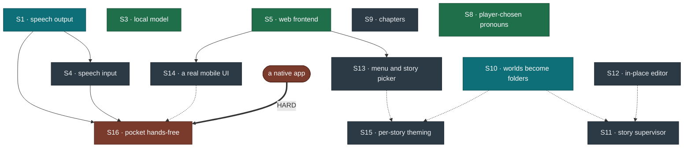

# Roadmap

What comes next for the engine and Adventure Lab, the browser app it runs in. This
file is the canonical list.

Items are numbered in the order they were proposed, **not** by priority. S16 is not
less important than S1, it is just newer. Numbers are never reused, which is why S6
and S7 are listed as dropped rather than renumbered away.

---

## The tree

Only **one** edge in this whole roadmap is genuinely hard. Everything else is a
preference with a price, so each soft edge below says what going around it costs.

*Green is shipped · teal is what I would pick up next · red is blocked on something
outside this project · slate is everything else. A solid arrow is a hard dependency,
a dotted one is a preference. S2 (braille) is shelved and sits outside the graph —
see the table below.*

The soft edges, and what each one costs to skip:

- **S10 → S11, S15** *(soft)* — both want somewhere to put a file. They can find one
  by naming convention instead, which is what we do now and what stops scaling around
  five worlds.
- **S9 → a second scene** *(soft, and possibly not a dependency at all)* —
  `move_player` already exists, so if a scene turns out to be four rooms and a
  conversation it needs no engine work. Writing one is what will decide.
- **A native app → S16** *(hard, and the only genuinely hard edge here)* — iOS
  suspends JavaScript when Safari is backgrounded and speech recognition stops with
  it. No amount of front-end work changes that.

**S8 was a cost curve, and it has been paid.** Pronoun templating is small while
there are a few hundred lines of prose and a rewrite once there are a few thousand,
so it went in before the prose grew rather than after it. The tokens exist, the
`pronouns` command sets them, and no prose has had to be revisited — because there
was none to revisit yet, which was the whole argument for doing it now.

---

## What I would do next

1. **S1 — speech output**, because the pitch is a game with no "real" visual version,
   and today the only version is visual. The renderer already produces the spoken
   register; nothing speaks it yet.
2. **S10 — worlds as folders**, because it is mechanical, it is cheapest now, and two
   other items are waiting on somewhere to put a file.
3. **A second scene**, now that S8 has cleared the way for one.

Everything else is genuinely optional and can happen in any order.

---

## Status

| | | |
|---|---|---|
| **S1** | speech output | 🟨 half done — the renderer's SPEECH register exists; nothing speaks it · *recommended next* |
| **S2** | braille / structured mode | ⏸ shelved — no way to validate it without a reader |
| **S3** | local model | ✅ done — WebLLM in the browser; 80% on the benchmark |
| **S4** | speech input | ⬜ not started — waits on S1 |
| **S5** | web frontend | ✅ done — Adventure Lab |
| **S6** | session durability | ✖ dropped — there is no server; the game runs in the browser |
| **S7** | Kubernetes manifests | ✖ dropped — deployed as a static site on CodeAI Cloud |
| **S8** | player-chosen pronouns | ✅ done — tokens and the `pronouns` command; a settings control belongs to S13 |
| **S9** | chapters | ⬜ not started |
| **S10** | worlds become folders | ⬜ not started · *recommended next* |
| **S11** | story supervisor | ⬜ not started |
| **S12** | in-place editor | ⬜ not started |
| **S13** | wrapper around the game loop | ⬜ not started |
| **S14** | a mobile interface worth using | ⬜ not started |
| **S15** | per-story theming | ⬜ not started |
| **S16** | pocket hands-free | ⛔ blocked — needs a native app |

---

## The items

- **S1 — Speech output.** 🟨 **Half done.** The renderer has a SPEECH register
  alongside the written one, and every turn already produces it (`renderSpeech`,
  split by who is talking so the droid can have its own voice): no decoration,
  blocked exits as their own sentences, and a room already visited loses its
  description entirely — 401 characters down to 149 on the third crossing of a
  corridor. What is missing is anything that says it aloud. Browser speech synthesis
  is the route — it works on any device — and the parser panel's slow-motion pacing
  should wait for the sentence to finish rather than for a timer.

  *Learned from the first build, which had it:* browser synthesisers can wedge
  silently, so a watchdog that cancels and retries a stuck utterance is not optional;
  and the system's voice list is full of novelty voices, so pick deliberately rather
  than taking the first English one.

- **S2 — Verbose/structured accessibility mode.** ⏸ **Shelved deliberately.**
  A verbose room mode, one short sentence per fact, for braille displays and
  screen-reader line navigation. The design work was done and most of it turned out
  not to be braille-specific at all: front-loading actionable facts, dropping
  decorative characters, one idea per line. All of that shipped in the SPEECH
  register instead.

  It is shelved for an honest reason rather than a scheduling one: **neither of us
  reads braille**, and building accessibility features without the users is how you
  get well-meaning garbage. Measured, a room entry costs eleven pans on a 40-cell
  display with the exits buried behind a seven-pan paragraph, so there is real work
  here — it just wants a reader in the room before it wants a programmer.

- **S3 — A model with no external API.** ✅ **Done, in the browser.** Adventure Lab
  runs small models on the player's own GPU through WebLLM, so nothing typed leaves
  the machine and there is no key to manage. The constraint that made this work was
  architectural rather than a better model: the model's output is limited by grammar
  to ids in view, it writes a plain-English paraphrase first, and the paraphrase goes
  back through the deterministic parser. That took Qwen2.5 1.5B from 37% to 80% on
  the benchmark; see [web/README.md](web/README.md#the-language-model-webllm) and the
  Benchmark view. Worth re-running whenever a better small model ships — the
  benchmark is there for exactly that.

- **S4 — Speech input.** ⬜ **Not started; waits on S1.** The target is the
  browser's own recognition driving a continuous hands-free loop: listen, play the
  turn, speak the reply, listen again, with the microphone shut while the synthesiser
  talks so the game does not transcribe its own voice and answer itself.

  *Two constraints the first build found the hard way.* **Speech input needs a secure
  context** — over plain http on a LAN address the browser refuses before offering a
  permission prompt, so hands-free needs https or localhost while speech *output*
  works anywhere. And **audible turn-taking is not decoration**: without a chime the
  player talks into a closed microphone and repeats themselves, which is legible in a
  log as "go north go north".

- **S5 — Web frontend.** ✅ **Done: Adventure Lab.** A 4:3 terminal for the game, and
  beside it the pipeline each command went through, a map, and the raw world state —
  built as a learning environment, so the inside of the engine is the point rather
  than a debug view. Runs entirely in the browser and deploys as a static site.

- **S6 — Session durability.** ✖ **Dropped.** This was about keeping games alive
  across server restarts and replicas. The game now runs in the player's browser, so
  there is no server session to lose; saves live in the browser's own storage.

- **S7 — Kubernetes manifests.** ✖ **Dropped.** Adventure Lab is a static site on
  CodeAI Cloud, which handles hosting, sign-in and budgets.

- **S8 — Player-chosen pronouns:** ✅ **done.** The player picks he/him, she/her or
  they/them with `pronouns <set>`. Prose writes `{they}`/`{them}`/`{their}` tokens,
  plus `{s}` and the four irregular verbs, and the renderer substitutes them **at
  render time** — so the choice can change mid-game, applies to prose written before
  the change, and travels in saves. A world declares the default its prose was
  written for (`"pronouns"` at the top of the world file); the player's choice
  overrides it. An unknown token like `{thier}` is left visible rather than deleted,
  because it is valid JSON and valid prose and nothing else would catch it.

  **Only the protagonist is templated.** Other characters' pronouns are words in
  their prose, which is correct — a character is who they are, not a setting.

  **No existing prose uses a token yet**, because the protagonist is "you" in every
  line currently written. That is the point: the mechanism landed while converting
  cost nothing. Converting hand-written pronouns to tokens in prose written from here
  is exactly the sweep **S11, the story supervisor**, should own — it is mechanical,
  it needs the whole world in view at once, and it is the kind of thing a human
  reviewer would rubber-stamp and an author would forget.

- **S9 — Chapters: more than one scene in a story.** A world file is currently a
  whole game, and a story told in scenes needs state to survive the boundary — what
  the player carries, which flags are set, who is travelling with them. `move_player`
  already moves someone between rooms, so a scene that is *more rooms in the same
  file* needs no engine work at all and is the cheap answer for two or three scenes.
  Separate files become worth it when scenes are long enough that one file stops
  being editable, and that is the version that needs design: a manifest naming the
  order, a declared carry-over set (inventory, named flags, companions), and an
  ending that names the next chapter rather than just an outcome. Worth doing before
  the second scene is written, not after, because retrofitting the carry-over means
  re-auditing every flag already in use.

- **S10 — Worlds become folders.** `worlds/wayfarer/` holding `world.json` as the
  load-bearing piece plus its companions: prose and voice notes, the story
  supervisor's instructions (S11), and eventually a theme (S15). Today those sit
  beside each other by naming convention, which works for two worlds and stops
  working somewhere around five. Touches the world import in `web/src/game.js`, the
  benchmark's cases, and the golden test — all mechanical, and all cheaper now than
  later. **Do this before S11 and S15**, both of which want somewhere to put a file.

- **S11 — Story supervisor.** A Claude skill that reviews a content diff for
  continuity breaks, dropped threads, and drift from a world's declared voice. It
  loads what the game never sees: a world's voice and continuity notes, which is where
  its unwritten rules — what a character would never do, what happened off-screen
  that no line states — actually live. Running it on `git diff` rather than the whole
  world keeps it cheap and points it at what just changed.

  *The case for it is that we have already done this job by hand and it found real
  bugs.* A single editing pass turned up an elapsed time stated one way in the intro
  and another way in five later lines, a location detail left over from a setting
  that had since changed, and a plot beat that quietly stopped working the moment the
  protagonist's equipment changed. None of those are things a test can catch, and all
  of them are things a careful reader catches every time.

  **It should also own the pronoun sweep.** S8 shipped `{they}`/`{them}`/`{their}`
  tokens and left every existing line alone, because every existing line says "you".
  As prose grows, some of it will name the protagonist in the third person with a
  hard-coded *he* or *she*, and finding those is exactly this job: mechanical,
  whole-world, and precisely the sort of thing an author forgets and a reviewer
  rubber-stamps. A visible `{thier}` catches a mistyped token; only a reader catches
  a correctly-spelled word that should have been one.

- **S12 — Editor mode in the web UI.** Click any piece of text in the running game
  and edit it in place. The pieces mostly exist: most strings the player reads
  arrive in events naming the entity or rule they came from, the loader rejects a broken
  world and names the problem, and the parser panel already shows two things in a
  room answering to the same word. An editor is those plus a way out.

  With no server, the way out is the browser: validate the edited world before
  accepting the change, keep it in browser storage while the author works, and let
  them download the world file to commit. Nothing can be written anywhere it
  shouldn't, which removes the hard part of the original design. Treat "the world no
  longer loads" as the failure mode to design against.

- **S13 — A wrapper around the game loop.** Main menu, story picker, global settings,
  and somewhere to arrive when you win or lose that is not a prompt telling you to
  type `restart`. Settings belong here too: pacing, the interpreter, speech once S1
  lands, verbosity, and a pronoun control alongside the `pronouns` command — the top
  bar is already running out of room, which is the first argument for this item
  existing.

- **S14 — A mobile interface worth using.** Taking cues from iMessage, the Claude and
  ChatGPT apps, and the interactive-fiction readers that already solved this: a
  conversation that scrolls naturally, an input that behaves like a keyboard expects,
  and status that does not push the story off the screen. Adventure Lab is designed
  for landscape screens — a terminal beside its panels — so a phone needs a layout of
  its own, probably the terminal alone with the panels a swipe away.

- **S15 — Per-story theming.** A different look per story — something warm for one,
  something colder for the Wayfarer. Lives in the world's folder (S10) so a world
  carries its own appearance, and should stay declarative — a palette and a typeface,
  not a stylesheet per story, or every new world inherits a maintenance burden.

- **S16 — Hands-free on a phone, screen off, in a pocket.** *This one has a hard
  blocker and it is worth stating before anybody starts.* iOS suspends JavaScript when
  Safari is backgrounded or the screen locks, and speech recognition stops with it. No
  amount of work on the web page changes that: **screen-off play is a native-app
  problem, not a front-end problem.** What the web version can be is excellent with the
  screen on and the phone face-down, which is worth doing on its own and is most of
  S14. If genuine pocket play is the goal, the honest options are a small native
  wrapper or a Shortcuts-driven voice loop, and both are a different project.
